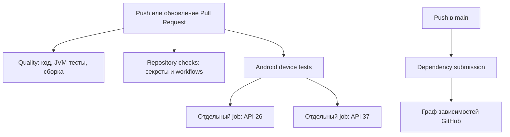

# Автоматизация GitHub Actions, CI, CD


> [!info] User question
> Подробно объясни как в проекте устроен CI \ CD. Насколько я понимаю, что он сделан на основе GitHub Actions. Что это и как работает. Объясни как для новичка, который не использовал ранее Github Actions. Объясни основные принципы. Дай базовые примеры. Т.е. дай вообще "Tutorial 101" и дополнительно объясни как это настроено и работает в текущем проекте. Объясни текцщие настройки \ конфигурации.

### Chat GPT 6.1 Sol response

Да, автоматизация проекта построена на **GitHub Actions**. Сейчас она проверяет код, собирает приложение, запускает тесты и передаёт GitHub информацию о зависимостях. **Автоматическая публикация приложения в Google Play пока не настроена.**

Я прочитал текущие workflows, Gradle-конфигурацию и вспомогательные скрипты. Ниже сначала объясню основные понятия, затем разберу настройки именно этого проекта. Файлы я не изменял.

**Начнём с того, зачем вообще нужен CI/CD.**

Представим обычную разработку Android-приложения:

1. Ты меняешь код.
2. Собираешь приложение.
3. Запускаешь тесты.
4. Проверяешь предупреждения анализаторов.
5. Готовишь релиз.
6. Публикуешь его.

Если выполнять всё вручную, легко забыть проверку или случайно опираться на особенности своего компьютера: установленные инструменты, старые результаты сборки, уже скачанные библиотеки.

CI/CD автоматизирует этот процесс.

|Термин|Расшифровка|Что означает|
|---|---|---|
|**CI**|Continuous Integration — непрерывная интеграция|Автоматически проверять изменения: собирается ли проект, проходят ли тесты, соблюдаются ли правила|
|**Continuous Delivery**|Непрерывная доставка|Автоматически подготавливать проверенный результат к выпуску; окончательная публикация может требовать решения человека|
|**Continuous Deployment**|Непрерывное развёртывание|Автоматически публиковать результат после успешных проверок|

Сокращение **CD** используют для двух последних понятий, поэтому полезно уточнять, что именно имеется в виду.

Для твоего проекта реализованы **CI и проверочная сборка release-пакетов**. Подпись production-ключом, создание опубликованного релиза и отправка в Google Play отсутствуют.

Например, CI может сказать:

> «После этого изменения приложение собирается, тесты проходят и анализаторы не нашли нарушений».

Но это ещё не означает:

> «Новая версия уже доступна пользователям».

---

**GitHub Actions — это сервис, который выполняет заданные тобой сценарии автоматизации.**

Сценарии хранятся прямо в Git-репозитории, в каталоге `.github/workflows`. Это текстовые файлы формата YAML.

Ты описываешь:

- **когда** запускать сценарий;
- **на каком компьютере** выполнять работу;
- **какие команды** выполнить;
- **какие результаты** сохранить.

GitHub запускает сценарий при подходящем событии и показывает результат. Сервис подходит для сборки и тестирования, а также для другой автоматизации. [Обзор GitHub Actions](https://docs.github.com/en/actions/get-started/understanding-github-actions).

Важное практическое следствие: **обычный локальный `git commit` сам по себе не запускает GitHub Actions**. GitHub должен получить изменения через `git push` или другое предусмотренное событие.

При использовании размещённых у GitHub runners работа выполняется на машинах GitHub. Твой компьютер может быть выключен.

**Чтобы читать конфигурацию, достаточно понять шесть терминов.**

|Термин|Значение|Пример|
|---|---|---|
|**Workflow**|Весь сценарий автоматизации|«Проверить качество проекта»|
|**Event / trigger**|Событие, запускающее сценарий|Отправка коммитов, открытие pull request|
|**Job**|Задание внутри сценария|Собрать приложение и запустить JVM-тесты|
|**Runner**|Машина, выполняющая job|Виртуальная машина с Ubuntu|
|**Step**|Отдельный шаг задания|Установить Java, запустить Gradle|
|**Action**|Готовый компонент автоматизации|Скачать репозиторий через `actions/checkout`|

Иерархия выглядит так:

```
Событие: отправлены коммиты
└── Workflow: проверить проект
    └── Job: сборка и тестирование
        ├── Step: скачать код
        ├── Step: подготовить Java
        └── Step: запустить Gradle
```

Шаги обычного job идут по порядку и используют одну машину. Разные jobs могут выполняться параллельно и имеют отдельное окружение. [Основные компоненты Actions](https://docs.github.com/en/actions/get-started/understanding-github-actions).

Ещё один термин — **workflow run**: конкретный запуск сценария. Workflow один, а запусков у него может быть много — после разных изменений.

---

**Вот самый простой учебный пример.**

Предположим, в репозитории есть файл `.github/workflows/hello.yml`:

```
name: Hello Actions

on:
  push:
  workflow_dispatch:

jobs:
  hello:
    runs-on: ubuntu-24.04

    steps:
      - name: Print greeting
        run: echo "Hello from GitHub Actions!"
```

Он делает только одно: выводит сообщение в лог.

Как его читать:

|Строка|Значение|
|---|---|
|`name: Hello Actions`|Название сценария в интерфейсе GitHub|
|`on:`|Перечень событий запуска|
|`push:`|Запуск при отправке изменений в GitHub|
|`workflow_dispatch:`|Возможность ручного запуска|
|`jobs:`|Перечень заданий|
|`hello:`|Внутренний идентификатор задания|
|`runs-on: ubuntu-24.04`|Выполнить задание на Ubuntu 24.04|
|`steps:`|Перечень шагов|
|`name: Print greeting`|Читаемое название шага|
|`run:`|Команда для выполнения|

В YAML **отступы определяют вложенность**. `steps` относится к `hello`, а `run` — к конкретному шагу. Символ `-` обозначает элемент списка.

Это учебный пример; я не добавлял его в проект. [Официальный пример workflow](https://docs.github.com/en/actions/tutorials/create-an-example-workflow).

**Два основных способа выполнять работу — `run` и `uses`.**

```
- name: Run tests
  run: ./gradlew :app:testDebugUnitTest
```

`run` запускает команду в оболочке — примерно как ты запускаешь команду в терминале.

```
- name: Checkout repository
  uses: actions/checkout@v5
```

`uses` запускает готовую action.

`actions/checkout` скачивает код репозитория на runner. Без этого шага у машины ещё нет твоих исходников.

Параметры action задаются через `with`:

```
- name: Set up Java
  uses: actions/setup-java@v5
  with:
    distribution: temurin
    java-version: '21'
```

Здесь выбирается дистрибутив Java Temurin и версия 21. Эти поля описаны в [синтаксисе workflows](https://docs.github.com/en/actions/reference/workflows-and-actions/workflow-syntax).

**Более практичный учебный пример — JVM-тесты Android-проекта.**

Сокращённая конфигурация на основе твоего окружения выглядела бы так:

```
name: Android unit tests

on:
  push:
  pull_request:
  workflow_dispatch:

permissions:
  contents: read

jobs:
  tests:
    runs-on: ubuntu-24.04

    steps:
      - uses: actions/checkout@v5

      - uses: actions/setup-java@v5
        with:
          distribution: temurin
          java-version: '21'

      - name: Install Android SDK packages
        run: |
          "$ANDROID_HOME/cmdline-tools/latest/bin/sdkmanager" \
            'platforms;android-37.0' \
            'build-tools;36.0.0'

      - name: Run unit tests
        run: ./gradlew :app:testDebugUnitTest --dependency-verification=strict
```

Последовательность:

```
Получить код → подготовить Java → установить SDK → запустить тесты
```

Это сокращённый пример для понимания. В настоящих workflows проекта добавлены проверка Gradle Wrapper, принятие SDK-лицензий, таймауты, сохранение отчётов и другие настройки.

Также в примерах выше action обозначены короткими версиями вроде `@v5`. **В текущем проекте используются конкретные SHA коммитов** — ниже объясню зачем.

---

**Теперь посмотрим на общую схему твоего проекта.**

В репозитории четыре workflow-файла:

|Workflow|Файл|Назначение|
|---|---|---|
|**Quality**|[quality.yml](D:/data_mike/develop/android/BrightnessControlAndDimmerRewrite/BrightnessControlDimmer/.github/workflows/quality.yml)|Проверки кода, JVM-тесты, сборка APK/AAB|
|**Android device tests**|[device-tests.yml](D:/data_mike/develop/android/BrightnessControlAndDimmerRewrite/BrightnessControlDimmer/.github/workflows/device-tests.yml)|Тесты на Android-эмуляторах API 26 и 37|
|**Repository checks**|[repository-checks.yml](D:/data_mike/develop/android/BrightnessControlAndDimmerRewrite/BrightnessControlDimmer/.github/workflows/repository-checks.yml)|Поиск секретов и проверка workflows|
|**Dependency submission**|[dependency-submission.yml](D:/data_mike/develop/android/BrightnessControlAndDimmerRewrite/BrightnessControlDimmer/.github/workflows/dependency-submission.yml)|Передача графа зависимостей в GitHub|

Обычная отправка изменений запускает такую схему:



Эти workflows **не выстроены в последовательную цепочку**. В них нет настройки, требующей сначала дождаться `Quality`, затем запускать эмуляторы. Они могут работать независимо и параллельно.

На обычном push получается четыре jobs: один quality, один repository checks и два эмуляторных. На push в `main` дополнительно предусмотрен job отправки зависимостей, если `main` является default branch.

**Когда запускаются проверки.**

У первых трёх workflows одинаковые события:

```
on:
  push:
  pull_request:
  workflow_dispatch:
```

Это означает:

- `push` — GitHub получил изменения;
- `pull_request` — PR открыт, повторно открыт или обновлён новыми коммитами;
- `workflow_dispatch` — ручной запуск.

**Pull request**, или PR, — предложение включить изменения одной ветки в другую. Например, из `feature/presets` в `main`. В нём удобно смотреть diff, обсуждать изменения и видеть результаты CI.

Обычный `pull_request` workflow с текущим `checkout` проверяет результат пробного объединения с целевой веткой. Это помогает обнаружить проблему, которая появляется именно при совместной работе изменений. [События запуска workflows](https://docs.github.com/en/actions/reference/workflows-and-actions/events-that-trigger-workflows).

У первых трёх workflows нет фильтров по изменённым файлам и веткам. Поэтому, например, изменение только документации тоже запускает сборку и device-тесты.

Если отправить коммиты в ветку с уже открытым PR, могут возникнуть **два отдельных запуска**: по событию `push` и по событию обновления PR.

---

**Workflow `Quality` — основная проверка приложения.**

Его задание выполняется на Ubuntu 24.04 с ограничением **30 минут**.

Шаги:

1. Получить код репозитория.
2. Подготовить Java 21 Temurin.
3. Проверить SHA256 файла `gradle-wrapper.jar`.
4. Принять SDK-лицензии и установить Android SDK-пакеты.
5. Выполнить Gradle-проверки и release-сборку.
6. Сохранить отчёты.

Главная команда:

```
./gradlew qualityCheck :app:bundleRelease \
  --no-daemon \
  --max-workers=2 \
  --dependency-verification=strict \
  --console=plain
```

**GitHub Actions здесь организует выполнение, а Gradle выполняет сборку и проверки.**

`qualityCheck` — собственная агрегирующая задача проекта, определённая в [build.gradle.kts (line 34)](D:/data_mike/develop/android/BrightnessControlAndDimmerRewrite/BrightnessControlDimmer/build.gradle.kts:34). Она зависит от нескольких задач:

|Проверка / задача|Что делает|
|---|---|
|`spotlessCheck`|Проверяет форматирование Kotlin и Gradle-файлов|
|`detekt`|Анализирует Kotlin-код, включая Compose-правила|
|`:app:lintDebug`|Выполняет Android Lint|
|`:app:testDebugUnitTest`|Запускает JVM-тесты|
|`:app:assembleDebug`|Собирает debug APK|
|`:app:assembleDebugAndroidTest`|Собирает APK с instrumented-тестами|
|`:app:assembleRelease`|Собирает release APK|
|`:app:koverHtmlReportDebug`|Формирует HTML-отчёт покрытия JVM-тестами|
|`:app:koverXmlReportDebug`|Формирует XML-отчёт покрытия|

Отдельно команда workflow вызывает `:app:bundleRelease`, чтобы собрать **AAB**.

APK — пакет для установки приложения на Android. AAB — формат, используемый для передачи приложения в Google Play.

Здесь есть важная граница:

> `assembleDebugAndroidTest` собирает тестовый APK, но не запускает тесты на Android.

Их запуск относится к следующему workflow.

**Что означают флаги команды.**

|Флаг|Назначение в проекте|
|---|---|
|`--no-daemon`|Не оставлять переиспользуемый Gradle daemon после выполнения; при необходимости Gradle использует одноразовый процесс|
|`--max-workers=2`|Ограничить число Gradle workers двумя, чтобы контролировать память|
|`--dependency-verification=strict`|Строго проверять скачиваемые зависимости|
|`--console=plain`|Получать простой текстовый лог без динамического оформления|

`--max-workers=2` ограничивает работу **внутри этого Gradle-запуска**. Он не означает, что во всём GitHub Actions может выполняться только два jobs.

В CI используется JDK 21. При этом Java/Kotlin bytecode проекта настроен на target 17 — это отдельная настройка, а не противоречие.

**Что сохраняется после `Quality`.**

В artifact с именем `verification-reports` попадают:

- отчёты проверки зависимостей;
- отчёты анализаторов, тестов и покрытия;
- XML-результаты JVM-тестов;
- release mapping-файлы R8.

Срок хранения — **14 дней**.

Для загрузки указан:

```
if: always()
```

Поэтому шаг сохранения отчётов выполняется и после ошибки предыдущих шагов. Если файлов нет, `if-no-files-found: warn` выдаёт предупреждение.

**Собранные APK и AAB сейчас не включены в этот artifact.** Workflow проверяет их сборку, но не загружает пакеты как скачиваемые результаты.

Release-сборка включает R8 и уменьшение ресурсов. Production signing не настроен: получение release APK/AAB ещё не делает их готовым опубликованным релизом.

---

**Workflow `Android device tests` проверяет приложение внутри Android.**

JVM-тесты работают в Java-окружении runner. Instrumented-тестам нужен Android: устройство или эмулятор, куда устанавливаются приложение и тестовый APK.

В проекте выбраны две версии:

|API|Зачем проверяется|
|---|---|
|**26**|Минимально поддерживаемая версия Android|
|**37**|Текущая целевая версия проекта; также позволяет выполнить accessibility-тест|

Конфигурация использует **matrix**:

```
strategy:
  fail-fast: false
  matrix:
    include:
      - api: 26
        sdk: '26'
      - api: 37
        sdk: '37.0'
```

Matrix создаёт два экземпляра одного задания с разными параметрами. Каждый получает свою машину и свой эмулятор.

Запись:

```
name: Device tests API ${{ matrix.api }}
```

даёт заданиям имена `Device tests API 26` и `Device tests API 37`.

`${{ ... }}` — выражение GitHub Actions. Здесь из параметров matrix берётся номер API.

`fail-fast: false` означает: падение одного задания matrix не отменяет второе автоматически. Можно получить результаты обеих версий Android. [Документация matrix](https://docs.github.com/en/actions/how-tos/write-workflows/choose-what-workflows-do/run-job-variations).

**Последовательность device job.**

1. Получить код, подготовить Java и Android SDK.
2. Собрать приложение и тестовый APK **до запуска эмулятора**.
3. Настроить доступ к KVM.
4. Запустить эмулятор.
5. Дождаться загрузки и разблокировки Android.
6. Запустить `connectedDebugAndroidTest`.
7. Проверить XML-результаты.
8. Сохранить отчёты.

KVM предоставляет аппаратное ускорение виртуализации на Linux. Оно нужно, чтобы Android-эмулятор работал с приемлемой скоростью.

Параметры эмулятора:

|Настройка|Значение|
|---|---|
|System image|Google APIs|
|Архитектура|`x86_64`|
|Профиль устройства|`pixel_7`|
|RAM|`2048M`|
|Диск|`4G`|
|Окно|Отключено|
|Анимации|Отключены|
|Snapshots|Отключены|
|Канал SDK|`stable`|
|Таймаут загрузки эмулятора|600 секунд|
|Общий таймаут job|30 минут|

Это одноразовый тестовый эмулятор на GitHub, не твой локальный эмулятор.

В job установлено:

```
env:
  ANDROID_SERIAL: emulator-5554
```

Так задаётся конкретное устройство для ADB и Gradle. Одинаковый serial у двух jobs не вызывает конфликт: они работают на отдельных машинах.

**Зачем отдельный скрипт ожидания готовности.**

[wait-for-test-device.ps1](D:/data_mike/develop/android/BrightnessControlAndDimmerRewrite/BrightnessControlDimmer/scripts/wait-for-test-device.ps1) проверяет два состояния:

```
sys.boot_completed = 1
user 0 = RUNNING_UNLOCKED
```

Загрузка системы ещё не гарантирует, что Android-пользователь разблокирован и обычная Activity доступна для запуска.

Скрипт будит эмулятор, снимает экран блокировки и ждёт нужного состояния до **180 секунд**. Если готовность не достигнута, завершает шаг ошибкой. Информация сохраняется в отчёт.

Это последнее исправление CI в текущем локальном commit `7cc49ac`.

**Зачем проверять XML после успешного Gradle-запуска.**

[check-device-results.ps1](D:/data_mike/develop/android/BrightnessControlAndDimmerRewrite/BrightnessControlDimmer/scripts/check-device-results.ps1) требует:

- наличие XML-отчётов;
- хотя бы один действительно выполненный тест;
- отсутствие failures/errors;
- отсутствие ситуации, когда все тесты пропущены.

В проекте ранее наблюдался случай, когда Gradle завершался успешно после проблемы установки APK, но реальные результаты тестов отсутствовали. Дополнительная проверка защищает от такого ложного успеха.

Автоматических повторов упавших тестов и подавления ошибок здесь нет.

**Какие тесты сейчас запускаются.**

По текущей документации:

- API 26 — три подходящих теста;
- API 37 — четыре теста, включая accessibility.

Проверяются package identity, отображение приветствия шаблона через Compose/UI Automator и доступность интерфейса.

Поведение изменения яркости, затемнения и сохранения настроек пока не реализовано и этими тестами не проверяется.

Каждый job сохраняет отдельный artifact:

```
device-test-results-api-26
device-test-results-api-37
```

Срок хранения — 14 дней. Туда входят результаты Android-тестов и диагностика готовности эмулятора.

---

**Workflow `Repository checks` проверяет сам репозиторий и CI-конфигурацию.**

Это отдельный job на Ubuntu 24.04 с таймаутом **10 минут**.

Он делает две проверки.

**Первая — Gitleaks.** Ищет случайно закоммиченные секреты: токены, пароли и другие похожие значения.

Для checkout задано:

```
fetch-depth: 0
```

Это позволяет получить полную историю вместо ограниченной выборки последних коммитов. Скрипт сканирует всю полученную историю Git.

Поэтому удалить секрет только из текущего файла недостаточно: он может остаться в старом коммите.

В проекте используется Gitleaks **8.30.1**. Находки полностью редактируются, чтобы не раскрывать значения секретов в выводе. Отчёты этой проверки не загружаются в artifacts.

**Вторая — actionlint.** Проверяет файлы GitHub Actions:

- структуру workflow;
- выражения;
- параметры actions;
- зависимости между jobs;
- некоторые опасные способы подстановки значений в shell-команды.

Используется actionlint **1.7.12**. На Ubuntu он также использует ShellCheck для Bash-блоков; PowerShell-блоки ShellCheck не анализирует.

Версии инструментов и SHA256 архивов заданы в [quality-tools.json](D:/data_mike/develop/android/BrightnessControlAndDimmerRewrite/BrightnessControlDimmer/config/quality-tools.json). Загрузчик проверяет архив перед использованием и повторно извлекает из него executable.

Эти проверки отделены от Gradle: обычная сборка приложения и Android Studio sync не должны скачивать Gitleaks и actionlint.

---

**Workflow `Dependency submission` помогает отслеживать уязвимые зависимости.**

У приложения есть не только прямо объявленные библиотеки, но и **транзитивные зависимости**:

```
Приложение → библиотека A → библиотека B
```

GitHub нужен фактически разрешённый Gradle-граф, чтобы знать используемые версии, включая библиотеку B.

Workflow запускает официальную Gradle action, которая разрешает зависимости и отправляет граф в GitHub. Это не сборка и не тестирование приложения. [Документация Gradle dependency submission](https://github.com/gradle/actions/blob/main/docs/dependency-submission.md).

События запуска:

```
on:
  push:
    branches: [main]
  schedule:
    - cron: '23 6 * * 1'
  workflow_dispatch:
```

Здесь предусмотрены:

- push в `main`;
- еженедельный запуск;
- ручной запуск.

Cron означает **понедельник, 06:23 UTC — 09:23 по Москве**. Плановые запуски могут задерживаться. [Правила событий и расписаний](https://docs.github.com/en/actions/reference/workflows-and-actions/events-that-trigger-workflows).

Дополнительно job разрешён только на default branch:

```
if: github.ref == format(
  'refs/heads/{0}',
  github.event.repository.default_branch
)
```

Это условие защищает отправку графа от запуска на произвольной ветке. Оно также означает: если default branch когда-нибудь перестанет быть `main`, push-фильтр нужно будет согласовать с новым именем.

Текущие настройки:

|Параметр|Значение|
|---|---|
|Runner|Ubuntu 24.04|
|Таймаут|20 минут|
|Gradle action|Закреплённая ревизия v6.4.0|
|Graph plugin|1.5.0|
|Режим|`generate-and-submit`|
|Cache provider|`basic`|
|Проверка зависимостей|`strict`|

Конфигурации `debugRuntimeClasspath` и `releaseRuntimeClasspath` помечаются как runtime-зависимости. Остальные относятся к development scope.

**Отправка графа сама по себе не включает Dependabot alerts.** Эти настройки включаются отдельно на GitHub. Их актуальное состояние я здесь не проверял.

---

**Dependabot — ещё одна часть автоматизации, но это не один из четырёх workflows.**

Его конфигурация находится в [dependabot.yml](D:/data_mike/develop/android/BrightnessControlAndDimmerRewrite/BrightnessControlDimmer/.github/dependabot.yml).

Он ищет обновления и создаёт PR с предложением обновить зависимости. [Документация Dependabot version updates](https://docs.github.com/en/code-security/how-tos/secure-your-supply-chain/secure-your-dependencies/configure-version-updates).

В проекте настроены:

|Экосистема|Периодичность|Лимит открытых PR для обновления версий|
|---|---|---|
|Gradle|Еженедельно|5|
|GitHub Actions|Еженедельно|3|

Для Gradle есть группы связанных обновлений:

- `android-toolchain` — Android Gradle Plugin и Kotlin/Compose compiler;
- `detekt-compose-rules` — Detekt и Compose Rules;
- `formatting` — Spotless и ktlint.

Группировка позволяет предложить связанные обновления в одном PR.

Сообщения коммитов используют префикс `chore` с областью изменения.

Здесь полезно различать:

|Механизм|Что делает|
|---|---|
|Dependabot version updates|Предлагает более новые версии|
|Dependabot alerts|Сообщает об известных уязвимостях используемых версий|
|Dependency submission|Передаёт GitHub фактический список зависимостей|

**Автоматическое слияние таких PR в проекте не настроено.** Обновление требует рассмотрения и проверки, в том числе изменений checksum metadata.

---

**Несколько общих настроек объясняют, почему workflows выглядят сложнее учебного примера.**

**Права доступа.**

У обычных проверок указано:

```
permissions:
  contents: read
```

GitHub выдаёт job временный `GITHUB_TOKEN`. `permissions` определяет его права. `contents: read` достаточно для чтения репозитория. [Документация GITHUB_TOKEN](https://docs.github.com/en/actions/concepts/security/github_token).

Только job отправки зависимостей получает:

```
permissions:
  contents: write
```

Этого требует отправка графа. Сам workflow не запускается на PR-коде с таким токеном.

У checkout также указано `persist-credentials: false`: credentials не сохраняются в локальной Git-конфигурации после получения кода.

**Закрепление actions на конкретном коде.**

В настоящем workflow используется, например:

```
uses: actions/checkout@fbc6f3992d24b796d5a048ff273f7fcc4a7b6c09 # v5
```

Длинная строка — SHA конкретного коммита action.

Комментарий `# v5` помогает человеку понять версию; запускаемый код определяет SHA. Такое закрепление обеспечивает неизменяемую ссылку на action. [Рекомендации GitHub по безопасности](https://docs.github.com/en/actions/reference/security/secure-use).

**Отмена устаревших запусков.**

Например, в `Quality`:

```
concurrency:
  group: quality-${{ github.workflow }}-${{ github.ref }}
  cancel-in-progress: true
```

Если отправить новое изменение для того же ref, старый незавершённый запуск этой группы отменяется.

Это экономит время: проверяется актуальное изменение. Push и PR могут иметь разные refs, поэтому эта настройка не устраняет все дублирующиеся проверки. [Документация concurrency](https://docs.github.com/en/actions/how-tos/write-workflows/choose-when-workflows-run/control-workflow-concurrency).

**Проверка скачиваемых файлов.**

В проекте несколько уровней:

|Уровень|Что проверяется|
|---|---|
|SHA256 в workflow|`gradle-wrapper.jar`|
|`distributionSha256Sum`|Архив Gradle 9.8.0|
|`verification-metadata.xml`|Зависимости Gradle и их metadata|
|`quality-tools.json`|Архивы Gitleaks и actionlint|

Для Gradle-зависимостей включён строгий режим. Исключения предусмотрены для IDE-вложений `*-sources.jar` и `*-javadoc.jar`.

Checksum подтверждает соответствие ожидаемому файлу. Он не означает, что библиотека не содержит уязвимостей — это другая задача.

**Cache и artifact — разные вещи.**

- **Cache** ускоряет будущие запуски, сохраняя повторно используемые данные.
- **Artifact** сохраняет результат конкретного запуска для просмотра или скачивания. [Различие cache и artifacts](https://docs.github.com/en/actions/concepts/workflows-and-actions/dependency-caching).

В `Quality` и device workflows нет явно настроенного межзапускового Gradle cache или cache эмулятора. `Dependency submission` использует `basic` caching provider.

Отчёты с хранением 14 дней — artifacts.

Для private-репозитория время runners и хранение результатов связаны с лимитами и оплатой GitHub Actions. Эмуляторные задания добавляют расход времени. Доступный лимит аккаунта я не проверял. [Billing and usage](https://docs.github.com/en/actions/concepts/billing-and-usage).

---

**Локальный pre-commit hook дополняет CI.**

В этом checkout настроен `core.hooksPath = .githooks`.

[pre-commit](D:/data_mike/develop/android/BrightnessControlAndDimmerRewrite/BrightnessControlDimmer/.githooks/pre-commit) перед созданием коммита выполняет:

```
Проверка staged changes на секреты
→ проверка workflows
→ Gradle qualityCheck
```

Если обязательная проверка падает, hook останавливает commit.

Различие такое:

|Механизм|Где работает|Когда|
|---|---|---|
|Pre-commit hook|На твоём компьютере|Перед локальным commit|
|GitHub Actions|На runner GitHub|После события в GitHub|

Hook позволяет раньше обнаружить проблему. CI проверяет отправленный код в отдельном окружении.

Локальный hook не запускает эмулятор и не собирает AAB: он вызывает `qualityCheck`, а не полную команду workflow `Quality`.

Для ручной проверки на Windows:

```
.\scripts\check-secrets.ps1 -StagedOnly
.\scripts\check-workflows.ps1

.\gradlew.bat qualityCheck `
  --dependency-verification=strict `
  --no-daemon `
  --max-workers=2
```

Чтобы добавить проверку сборки AAB:

```
.\gradlew.bat qualityCheck :app:bundleRelease `
  --dependency-verification=strict `
  --no-daemon `
  --max-workers=2
```

Для device-тестов отдельно требуется выделенное устройство или эмулятор.

---

**Как пользоваться результатами CI на GitHub.**

Обычный рабочий цикл:

1. Изменить код.
2. Выполнить локальные проверки.
3. Создать commit.
4. Выполнить push.
5. Открыть вкладку **Actions** в репозитории.
6. Посмотреть результаты нужного запуска.

Внутри запуска выбирается job, затем шаг. Там находится его лог. [Просмотр workflow logs](https://docs.github.com/en/actions/how-tos/monitor-workflows/use-workflow-run-logs).

При ошибке полезно начинать с **первого упавшего рабочего шага**:

|Упавший шаг|Где искать причину|
|---|---|
|`Verify wrapper JAR`|Несоответствие checksum Gradle Wrapper|
|`Install Android SDK packages`|SDK-пакеты, лицензии, загрузка|
|`Check and build`|Gradle, компиляция, проверки, JVM-тесты|
|`Run instrumented UI tests`|Готовность эмулятора, установка APK, Android-тесты|
|`Require executed and passing device tests`|Пустые результаты, пропущенные или упавшие тесты|
|`Scan Git history for secrets`|Находка Gitleaks|
|`Check GitHub Actions workflows`|Ошибка actionlint|
|`Resolve and submit dependency graph`|Разрешение зависимостей или отправка графа|

Если ошибка относится к Detekt, Lint или тестам, artifact с HTML/XML-отчётами часто удобнее длинного консольного лога.

Ручной запуск доступен через **Actions → выбранный workflow → Run workflow**, если файл с `workflow_dispatch` присутствует на default branch.

Красная проверка сама по себе не обязательно запрещает merge. Для обязательного блокирования нужно отдельно настроить required status checks в branch protection или rulesets. Эти серверные настройки не определяются прочитанными YAML-файлами; их состояние я не проверял.

---

**Что сейчас подтверждено, а что ещё требует проверки.**

По локальной конфигурации видно, что проверки и команды настроены. Документация проекта отдельно фиксирует историю GitHub-запусков:

- для `40a7b12` прошли repository checks, quality и API 26; API 37 упал на UI-тестах;
- после изменения запуска Activity в `774f737` API 37 всё ещё падал; в logcat обнаружено заблокированное состояние Android-пользователя;
- текущий commit `7cc49ac` добавляет ожидание `RUNNING_UNLOCKED`.

[TESTING.md (line 103)](D:/data_mike/develop/android/BrightnessControlAndDimmerRewrite/BrightnessControlDimmer/TESTING.md:103) указывает, что исправлению ожидания разблокировки нужен новый подтверждающий hosted run. **Текущие удалённые запуски GitHub я в этом разборе не проверял**, поэтому не утверждаю, что последний CI уже полностью зелёный.

Текущий набор тестов проверяет инфраструктуру и шаблонный экран. Покрытие application-кода JVM-тестами ожидается на уровне 0%, и порог покрытия не установлен. Успешный CI сейчас подтверждает работоспособность подготовленного проекта в пределах этих проверок; по мере реализации яркости, затемнения и persistence понадобятся тесты соответствующего поведения.

Для полноценного выпуска ещё потребуются production signing, управление release-версиями и процедура публикации. Сейчас CI подготавливает основу для разработки и проверяет сборку, а выпуск приложения остаётся отдельной задачей.