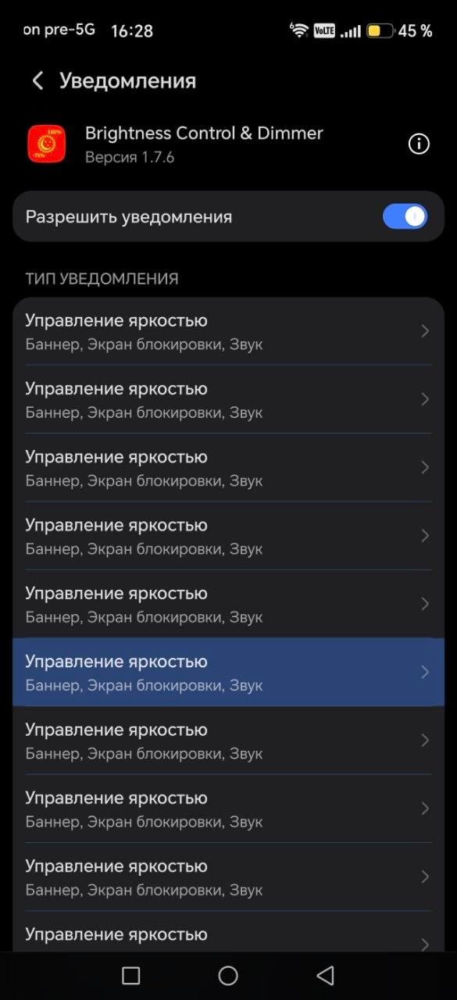
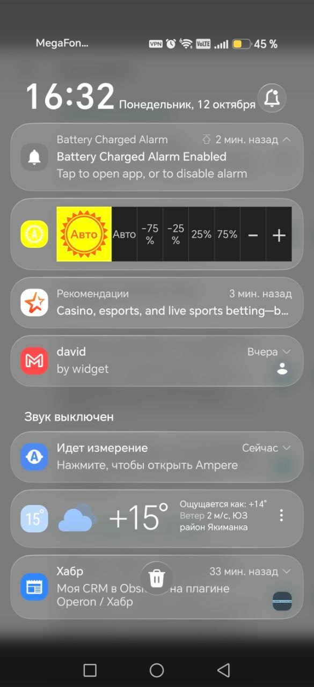

# Уведомление Legacy на Honor Magic 7 Pro

[Глоссарий: термины и обозначения](glossary.md).

Дата получения: 2026-10-12. Пользователь сообщил устройство **Honor Magic 7 Pro**
и предоставил два снимка Legacy. На экране настроек указана версия **1.7.6**.
Версия Android/MagicOS, масштаб шрифта/интерфейса и история действий не сообщены;
по снимкам их не определять. Оригиналы сохранены без изменений, SHA256 копий
совпадает с предоставленными файлами. Это свидетельство пользователя, не запуск
или воспроизведение агентом. Анализ кода привязан к Legacy HEAD
`cd7696cd04705fa48a2c115addf98ae6191bfdd9`; идентичность установленного APK этому
коммиту не проверена.

## 1. Одноимённые каналы

- **Экран:** системные настройки уведомлений BCD.
- **Наблюдаемое состояние:** видны многочисленные строки **«Управление яркостью»**.
- **Предшествующие действия:** неизвестны; нельзя восстановить их по одному снимку.
- **Проверенный механизм в исходниках:** новый экземпляр `DimmerService` создаёт
  идентификатор канала из префикса и текущего времени (`:142–143,983–985`),
  а `onCreate` регистрирует его (`:218–220`). ID не хранится между экземплярами.
  `recreateNotificationChannel` удаляет только ID текущего экземпляра (`:646–670`);
  другого удаления/перечисления предыдущих ID в production коде не найдено.
- **Вывод:** после повторного создания сервиса в другое время старые каналы
  могут остаться зарегистрированными. Это конкретный дефект управления каналами
  Legacy, согласующийся со снимком. Сам снимок не показывает ID, удалённость
  каналов и точную последовательность, создавшую все строки.
- **Историческая причина:** timestamp/delete/create введены коммитом
  `91e4fbf72f38b483ee5a1efc35458bbfb32426ef` от2019-02-02 для изменения importance
  из BCD. Уже в этом коммите ID инициализируется временем при создании сервиса.
  Назначение смены приоритета не оправдывает оставшиеся каналы.
- **Принятый результат новой версии:** стабильный ID канала управления яркостью,
  без роста числа таких каналов при запуске, toggle и пересоздании сервиса;
  пользовательские настройки сохраняются. Это повторное использование канала,
  а не удаление и создание нового при каждом запуске.

[Документация Android](https://developer.android.com/develop/ui/compose/notifications/channels)
разрешает повторно регистрировать тот же канал с исходными параметрами без
изменения его поведения; пользователь управляет importance. ОС также может
показывать сведения об удалённых каналах, поэтому количество видимых строк
само по себе не доказывает количество действующих ID.

## 2. Малая иконка и подписи кнопок

- **Экран:** раскрытая системная панель Android; уведомление BCD среди других.
- **Наблюдаемое состояние:** малая иконка содержит белую **«A»** на ярком жёлтом
  фоне. Пользователь сообщает плохую читаемость. В большой области показано
  **«Авто»**; отдельная кнопка Auto дублирует эту надпись. Подписи **−75%** и
  **−25%** разорваны: процент находится на следующей строке; **25%** и **75%**
  на снимке цельные. Малые числовые иконки в других режимах здесь не показаны.
- **Действия пользователя:** снимок фиксирует внешний вид; нажатия не показаны.
- **Сопоставление с кодом:** `makeStatusBarIconId` выбирает ресурс по значению/Auto,
  затем `prepareBuilder` передаёт его в `setSmallIcon` (`DimmerService.java:855–904`).
  `notification_controls.xml:12–38` выделяет большую область 64dp под изображение
  и текст состояния. Остальные семь кнопок делят ширину одной строки с одинаковыми
  весами; `TextView` пресетов не ограничены одной строкой. Размер их текста задан
  ресурсом из `values-small/dimens.xml` (12dp). Это объясняет риск нехватки ширины,
  но не доказывает все параметры рендеринга конкретной прошивки.
- **Мотивы Legacy:** отдельная числовая/Auto иконка служит быстрому отображению
  состояния; большая область открывает BCD, строка даёт все быстрые команды.
  Обход `DecoratedCustomViewStyle` добавлен в2023 году против невидимых controls,
  а не как утверждённый макет новой версии. Сохранить смысл быстрого доступа;
  конкретную компоновку Legacy переносить не требуется.
- **Требования новой версии по замечаниям пользователя:** читаемое текстовое
  значение/Auto отдельно от малой иконки; целые подписи с минусом и процентом,
  без обрезки и наложения; различимые кнопки с удобными областями нажатия.
  Проверить светлую/тёмную тему, увеличенные шрифт/масштаб, узкую область и
  свёрнутый/развёрнутый вид. Не решать проблему только уменьшением шрифта.
  Цвета, числовые размеры, число строк команд и окончательный макет ещё не выбраны.

[Официальные рекомендации custom notification](https://developer.android.com/develop/ui/views/notifications/custom-notification)
предупреждают об ограниченной области, различиях устройств/ориентаций и темы;
это основание для будущей проверки, а не подтверждение выбранной реализации.

## 3. Связи и границы

DEC-008/RULE-014–RULE-015; SCN-020/SCN-021; TEST-020/TEST-021.
Все [восемь случаев группы4](../workflows/group4-notifications-and-permissions-review.md)
приняты тем же ответом. Прочие UI-поверхности и группа5 не приняты автоматически.
Доступ к устройству, dumps каналов и проверка новой версии не выполнялись.
При совместимом обновлении исследовать существующие старые каналы и сохранение
пользовательских предпочтений; безопасный порядок их миграции/очистки ещё не выбран.
Не считать очистку данных приложения допустимым способом исправления миграции.
