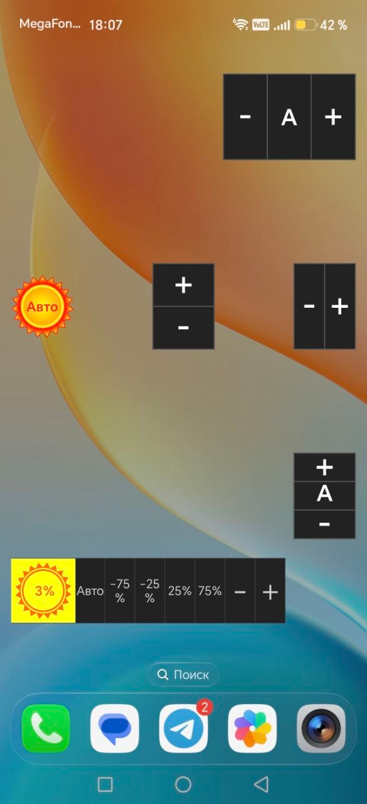

# Справочный снимок виджетов Legacy

Получен 2026-10-12 от владельца проекта после прямого принятия всех 16 случаев
группы5. [Глоссарий](glossary.md), [принятые случаи](../workflows/group5-widgets-and-exclusions-review.md),
[исследование E17–E20](source-evidence.md), [реестр BUG](../bugs/bug-register.md).

## Источник и сохранность

Исходное вложение: codex-clipboard-8d463847-b567-4656-8cab-eb2fd6b8dcb4.png.
Копия сохранена без изменения байтов. SHA256 исходного PNG и копии:
59ea31d7d07003afb29de55f4299af1f795115e0a77315302433609c8140b811.
Номер версии BCD, модель, Android/прошивка, launcher и масштаб не сообщены.
Не переносить окружение Honor из другого свидетельства или Android16 из BUG-001.
Видимое 18:07 — надпись на снимке, не установленное время получения/съёмки.

## Что наблюдается и чего снимок не доказывает

- Виджет значения с солнечной иконкой и текстом «Авто».
- Горизонтальные +/- с Auto и без него.
- Вертикальные +/- с Auto и без него.
- Виджет общих кнопок: значение 3%, Auto, -75%, -25%,25%,75%, минус/плюс.
  У -75/-25 процент переносится на следующую строку в этой ширине.

Это наблюдение изображения и справка по составу/Legacy оформлению, не проверка
кликов, индивидуального шага, сохранности Cancel/Delete, системного режима/raw или
реального состояния overlay. Различие «Авто»/«3%» на одном изображении само
не устанавливает причину или баг синхронизации. 3% не доказывает обход защитного floor.
Снимок не воспроизводит BUG-001 после включения экрана.
Макеты/числовые иконки/размеры/цвета новой версии не утверждены этим вложением.
